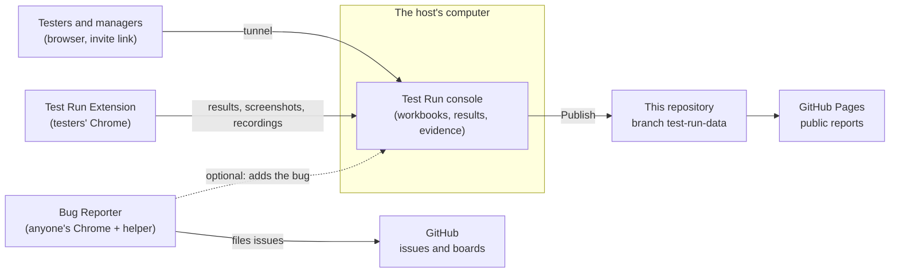

# Claude Extensions

Tools for everyday QA work on web apps: run manual test cycles as a team, collect evidence while you test, and file well-written bugs in one go. Some of them use Claude, through your own Claude Code login.

| What | What it is | Who it's for |
|---|---|---|
| [**Test Run console**](test-run-console/) | A web app for manual test runs on your `.xlsx` test case workbooks. Shows what to test next, marks results with one click or one key, writes them into the workbook, and gives management a summary. One person runs it; testers and managers join with links; reports can be published for anyone to read. | Test leads, testers, managers |
| [**Test Run Extension**](test-run-console/extension/) | A Chrome extension that works with the console: mark the case you're testing from the toolbar, with a screenshot or a screen recording as evidence. | Testers using Test Run |
| [**Bug Reporter**](bug-reporter/) | A Chrome extension and a small local helper, on its own. Record while you test, halt on a defect, and file a GitHub issue with a screenshot, a trimmed video, the failing API calls and the project board fields; Claude writes the description. Also re-tests existing issues and tracks missing localizations. | Anyone filing bugs |

## Pick your path

- **I only want to file bugs faster.** Install Bug Reporter: follow its **[setup guide](bug-reporter/docs/SETUP.md)** (about 10 minutes). Nothing else from this repository is needed.
- **I run test cycles with a team.** Start the **[Test Run console](test-run-console/README.md#quick-start)** on your computer, invite your testers, and have them install **[Test Run Extension](test-run-console/extension/README.md)**. Bug Reporter can add the bugs they file straight into Test Run.
- **I've been sent a Test Run link.** Open it in your browser; that's all you need to mark results. For screenshots and recordings, install [Test Run Extension](test-run-console/extension/README.md).

## How the pieces fit



- **Test Run** runs on one computer, the host's. Everything it holds stays there. Teammates reach it through a tunnel (Cloudflare or Tailscale) with their own invite links.
- **Test Run Extension** only talks to Test Run.
- **Bug Reporter** talks to GitHub through your own `gh` login, and to Claude through your own Claude Code login. If Test Run is reachable, it can also add the bug there.
- **Publishing** commits the reports (and the workbooks you tick) to this repository; the GitHub Pages site shows them.

## Requirements

| | Test Run console | Test Run Extension | Bug Reporter |
|---|---|---|---|
| Operating system | macOS (Linux should work; not tested) · testers joining by link: any | any with Chrome | macOS or Linux |
| Browser | any, for the pages | Chrome 116+ | Chrome 116+ (or Chromium, Brave, Edge) |
| Node.js 18+ | yes | only to run its tests | yes (for the helper) |
| GitHub CLI | optional: issue titles, the tunnel's gist, publishing | no | yes, 2.104+, with the `project` scope |
| Claude Code | no (drafting is switched off for now) | no | for drafting with Claude only |
| Other | `cloudflared` or Tailscale, only to share with a team | an access link | — |

No API keys are needed anywhere. Claude drafts use your Claude subscription through your own Claude Code login.

## Your data and privacy

**Stays on the computer it's on:**
- Test Run's workbooks, results, screenshots and recordings, invite keys and settings: in `test-run-console/sheets/` on the host's computer, which git ignores.
- Bug Reporter's captured API calls and console errors (Chrome's storage), and attachments waiting to be filed (a cache folder, cleared after 3 days).

**Leaves the computer:**
- **Issues you file** with Bug Reporter go to GitHub, with the API calls you tick **unredacted** (DIGIT requests carry a live `authToken`): be careful with public repositories.
- **Claude drafts** send a summary of the bug (plus the ticked calls in *Detailed* mode, and the screenshot if you tick it) to Claude through your Claude Code login.
- **While Test Run is shared**, it's reachable from the internet through the tunnel. The page is public; everything else needs an invite key. If a link leaks, make that person a **New link** (or **Remove** them) in Setup › Sharing; the old link stops working at once.
- **The Complete Report** zip holds every screenshot and recording. Only the host can download it.

> **What's published is public.** The `test-run-data` branch of this repository, and the GitHub Pages site built from it, can be read by anyone: the published workbooks (test cases, results, comments, findings, tester names, issue links) and their reports. Each publish replaces that branch with one commit, so what's unpublished leaves it, but anyone may have kept a copy. Screenshots, recordings, invite keys and settings are never published.

## What's in this repository

```
README.md               this page
DESIGN.md               the design guide for every UI here (from the Test Run console)
docs/
  design-alignment.md   plan to bring both extensions in line with DESIGN.md
test-run-console/       Test Run: the console (Node app, server + web UI)
  extension/            Test Run Extension (Chrome)
  published/            what the host published before the test-run-data branch (read until it exists)
bug-reporter/           Bug Reporter: extension/ (Chrome) + host/ (local helper) + docs/
.github/workflows/      publishes the Test Run page and reports to GitHub Pages
```

There's no build step: every UI is plain HTML, CSS and JavaScript. The extensions load from their folders with **Load unpacked**.

## Updating

```bash
git pull
```

Then, for what you use:
- **Test Run console:** `cd test-run-console && npm install`, then restart it (Ctrl+C, `npm start`).
- **Test Run Extension:** click **↻** on it in `chrome://extensions`.
- **Bug Reporter:** run `bug-reporter/host/install.sh` again, then click **↻** in `chrome://extensions`.

Unpacked extensions never update by themselves.

> **Moved:** Test Run Extension used to be in `test-run-extension/`; it's now in `test-run-console/extension/`. If you loaded it from the old folder, remove it in `chrome://extensions`, load the new folder, and paste your access link again.

## Tests

Each product has its own tests, with no extra setup:

```bash
cd test-run-console && npm install && npm test   # the console and Test Run Extension
cd bug-reporter && npm test
```

The console's browser tests (which also drive both extensions) need Playwright: set `PLAYWRIGHT_DIR` to an installed `node_modules/playwright` folder, or they're skipped.

## Versions

| | Version |
|---|---|
| Test Run console | 0.1.0 |
| Test Run Extension | 0.1.0 |
| Bug Reporter | 0.2.0 |

## Working on this repository

- **Design:** every UI follows [DESIGN.md](DESIGN.md). New screens reuse its tokens, components and writing rules.
- **Branches:** `master` is what's live. GitHub Pages redeploys the Test Run page when `test-run-console/ui/` changes on `master`, and Test Run starts it after each publish.
- **Publishing commits:** the `test-run-data` branch is Test Run's own: each publish replaces it with one commit titled `Test Run: publish …`. Don't commit to it by hand: the next publish replaces it.
- **Before a change:** run the tests of the product you touched.

## What's next

- Bring both extensions in line with the design guide ([docs/design-alignment.md](docs/design-alignment.md)).
