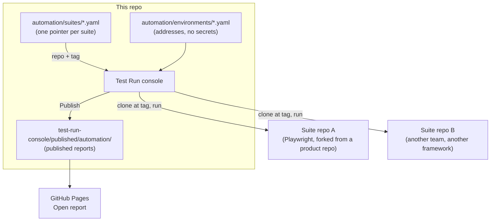

# Automation

This folder is the **catalogue of automated test suites** that Test Run knows about, and the environments they can run against. It holds no test code. Each suite stays in its own repository, owned by its team, built on whatever framework that team chose.

> **Status:** planning. Nothing here runs yet. Today, automated results reach Test Run through a workbook tab set to **Automation results** (see [Automation results today](#automation-results-today)). This folder fixes the layout so suites can be added now and run from Test Run later.

## The idea in one picture



## What a run will look like (planned)

1. Someone allowed to run automation picks a **suite**, a **product version**, an **implementation** and an **environment** in Test Run.
2. The host (the computer running Test Run) clones the suite's repository at the tag or branch the catalogue gives for that version and implementation, into a working folder outside git.
3. It runs the catalogue's `setup` and `run` commands, with the environment's address, tenant and secrets passed in.
4. It keeps the suite's **own report** (an Allure report, a Playwright HTML report, or whatever that team uses). Test Run doesn't read or convert anyone's results.
5. **Publish** (its place in the UI is decided later) commits that report to `test-run-console/published/automation/<suite>/<run>/` in this repo, and GitHub Pages serves it.
6. In Summary › Automation, **Open report** goes to the published report, as it is.

Runs are kept on the host next to the console's data, in `sheets/.testrun/runs/<suite>/<run>/`.

### Published reports
- **Only the latest report per suite is kept, by default.** An admin setting in Test Run chooses how many to keep for each suite; older ones are removed at the next publish.
- **Screenshots, videos, traces and other attachments are never published.** Only the report's pages and data go to git (no images, `.webm`, `.mp4`, `.zip` and the like). This keeps the repository small: GitHub warns at 50 MB per file and refuses 100 MB. The report still opens; links to a left-out file show as unavailable.
- **Published reports are public**, like everything under `test-run-console/published/`. Text attachments such as request logs can contain tokens, so they're checked before publishing.

## Adding a suite

1. Make sure the suite has a repository you can clone:
   - your own suite: create a repository, or fork one from a product repository (see [Keeping a suite you own](#keeping-a-suite-you-own));
   - another team's suite: nothing to do in their repository. Just note where it is.
2. Copy [`suites/_example.yaml`](suites/_example.yaml) to `suites/<id>.yaml` and fill it in. Every field is described in [CATALOGUE.md](CATALOGUE.md).
3. Add any environment it runs against: copy [`environments/_example.yaml`](environments/_example.yaml) to `environments/<name>.yaml`.

Nothing is ever added to, or changed in, another team's repository or reporting. Everything Test Run needs to know about a suite is in its catalogue file here.

## Versions and implementations

A suite often needs to differ by **product version** (2.8, 2.9, …) and by **implementation** (the same product set up for different customers, with their own workflows and data). The catalogue maps each combination to a git **ref** (a tag or branch) in the suite's repository, plus an optional **overlay**:

| What differs | How it's kept in the suite repo | What the catalogue says |
|---|---|---|
| Product version | a `release/<version>` branch, with tags such as `v2.9.3` | `versions[].default: v2.9.3` |
| Implementation, same code | an overlay folder, `implementations/<name>/`, with its settings, test data and which tests to include | `implementations.<name>: { ref: v2.9.3, overlay: implementations/<name> }` |
| Implementation, different code | a branch `impl/<name>-<version>`, only when the code really differs | `implementations.<name>: { ref: impl/<name>-2.9.1 }` |

Pointing at **tags** rather than branches means a run is repeatable: the same tag always runs the same tests.

## Keeping a suite you own

This is advice for suites you maintain yourself, for example one forked from a product repository.

- **Keep in step with the product repo.** Git calls the original repository `upstream`; your fork is `origin`. Add it once:
  ```bash
  git remote add upstream https://github.com/<product-org>/<product-repo>.git
  ```
  When they release, bring their changes in:
  ```bash
  git fetch upstream --tags
  git merge upstream/<their-release-branch-or-tag>
  ```
  Fix any conflicts, run the tests, push to your fork, and tag it.
- **Keep your own tests in their own folder.** When your additions don't touch the files the product team edits, merges from upstream stay small.
- **Prefer overlays to branches.** An implementation that only needs different settings, data or a different set of tests is an overlay folder. A branch is for code that really differs, and every branch has to be kept in step.
- **One suite, one owner.** Suites from different teams sit side by side here, one file each, maintained by the team that owns the suite.

## Reports from different frameworks

Each team keeps its own reporting: Allure, Playwright's HTML report, or anything else that produces a folder of HTML. The catalogue's `report` field says:
- where the report lands after a run (`folder`);
- the command that builds it, if building is a separate step (`build`, for example `allure generate`);
- or the address where the team already publishes it (`url`), if Test Run should link there instead.

## Linking automated tests to manual cases (later)

Automated tests aren't tagged with manual case IDs yet. The catalogue reserves an optional `caseIds` field (for example, tests tagged `@CMS/09`), so this can be switched on later without changing the format.

## Environments and secrets

`environments/<name>.yaml` holds what an environment *is*: its address, tenant, implementation and product version, and the **names** of the secrets a run needs (user names, passwords, tokens). Secret **values** never go in git; they stay on the host and are passed to the run as environment variables.

## Automation results today

Until runs start from Test Run, automated results come in through the workbook:
- a workbook tab set to **Automation results** in Setup › Workbook, with a spec-file column and a status column per cycle (the sample workbook from `npm run demo` has one);
- Summary › Automation shows its totals, figures per file and the failing tests;
- manual cases that name a spec file show an **Auto ✓ / ✗** badge in Run.

## Files

| File | What it is |
|---|---|
| [CATALOGUE.md](CATALOGUE.md) | Every field of a suite's catalogue file and an environment file |
| [suites/_example.yaml](suites/_example.yaml) | A commented example suite; copy it to start one |
| [environments/_example.yaml](environments/_example.yaml) | A commented example environment, with no secrets |
