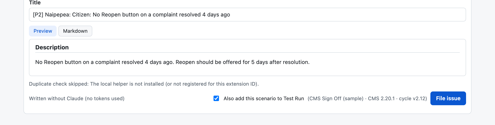

# Test Run console

A small local app for **manual test runs on your test case workbooks** (`.xlsx`). It shows you what to test next, colour coded, and you mark results with one click or one key. Each result is saved straight into the workbook on your computer. Managers get a clean summary page you can print or send.

Everything stays on your computer: the workbooks live in `sheets/`, which git ignores. Claude helps write up test cases and plan test runs through your own Claude Code login, the same way Bug Reporter does. There is no API key and nothing to deploy.

| Run | Summary for management |
|---|---|
|  |  |

## Start it

You need Node.js 18 or later. Claude Code is optional, for Claude help.

```bash
cd test-run-console
npm install
```

```bash
npm start
```

That opens http://127.0.0.1:5178. Put your workbooks in `test-run-console/sheets/`, or use **Import** in the console. Stop it with Ctrl+C in that terminal.

Want to look around first? Run `npm run demo`. It uses a throwaway copy of a sample workbook.

## What it does

- **Run.** Cases are grouped into *test paths*: by Feature then Sub feature, or by a plan Claude made.
  - Each case is one line: a status dot, the ID, the scenario and badges.
  - Click a case to see its pre condition, test data and expected result as bullets.
  - Mark it with **P**, **F**, **N** or a button. Focus moves to the next untested case, and **U** undoes.
- **Colour and symbol together.** ✓ pass, ✗ fail, – other, ○ not run, so results stay readable for colour-blind readers and on paper.
- **Focus on risk.** Untested cases sort into four groups: new in this release, failed last cycle, manual only, and automation already passing.
- **Automation badges.** If the workbook has the automation sign-off tab, cases whose comment names a spec (e.g. `inbox-search.spec`) show its latest result: **Auto ✓**, **Auto ✗** or **Auto ~**.
- **Cycles.** Each cycle is a pair of columns, `Test Status` and `Comment`, as your sheets already have.
  - **Start new cycle** adds the next pair beside the last one, with the same header style, dropdown and formatting.
  - Earlier cycles stay, so you can compare.
- **Findings.** Something unplanned failed? Log the bug, then note it in one line with the bug number. With Bug Reporter, one tick does this for you (see below).
- **Claude drafting.** Tick findings and click **Draft with Claude**. Claude writes test cases in your house style, suggests edge cases and flags likely duplicates. On the Plan screen, **Plan paths with Claude** groups cases into paths one person can run in a single pass.
- **Inbox.** Every draft waits here for review. Edit, reject, or **Add to workbook**, which appends the row with the workbook's next ID (`CMS/183`) and the last row's formatting.
- **Summary.** Shows percent executed, pass rate, a colour strip per feature, open failures with issue links, and a comparison with the previous cycle. **Export summary** saves it as one HTML file you can send. **Update summary tab** writes it into the workbook.
- **Any layout.** Columns are found by header name, including headers on two lines such as `Test Status` / `v2.12`. Setup lets you fix anything it got wrong.

## Claude: defaults, and a different model for one draft

Setup → **You and Claude** holds the defaults:

| Default for | Model | Effort |
|---|---|---|
| Writing up findings | Sonnet 5.5 | Low |
| Planning test paths | Sonnet 5.5 | Medium |

Each Claude button has its own **Model** and **Effort** dropdowns, prefilled from these defaults. Change them for one draft, for example Opus for a tricky area or Haiku for a quick one. After each run a line shows the model, effort, tokens, time and API-equivalent cost, as in Bug Reporter.

How Claude is used:
- **Same runner as Bug Reporter.** Test Run reuses Bug Reporter's Claude runner (`bug-reporter/host/lib/claude.mjs`): one `claude -p` call, no tools, no MCP servers, no saved session, and never an API key.
- **Instructions:** `skill/test-run/SKILL.md`.
- **What Claude receives:** only the findings you ticked and the titles of related cases, so it can spot duplicates.
- **Turning it off:** the **Claude help** switch hides every Claude button.
- **Without Claude Code:** **Copy prompt** gives you the text to use elsewhere. Paste the reply into the Inbox.

The exact prompt texts are in [`prompts/`](prompts/).

## With Bug Reporter

While Test Run is running, Bug Reporter's review screen shows a checkbox next to **File issue**, with where the note will go:



- **Ticking it:** once the issue is filed, the bug lands in Test Run as a finding. It carries the title, the issue link, the drafted Actual and Expected text, and the module, and shows **from Bug Reporter**.
- **In Test Run:** a toast tells you, and **Draft with Claude** turns it into a test case.
- **The checkbox** starts unticked and remembers your last choice. When Test Run isn't running, it doesn't appear.
- **Settings:** Bug Reporter options → **Test Run** has the on/off switch, the port, and **Check now**.

Loading this branch's Bug Reporter: in `chrome://extensions`, remove the Bug Reporter you have loaded, then **Load unpacked** this worktree's `bug-reporter/extension` folder. Both copies have the same extension ID, so only one can be loaded at a time; the native helper keeps working without reinstalling.

## Your workbooks

- **Where they live:** `sheets/*.xlsx`, never committed. Settings, findings, inbox drafts and path plans for a workbook are kept beside it in `sheets/.testrun/<workbook>.json`, so the workbook itself only holds test data.
- **What changes in the workbook:**
  - the status, comment and issue cells you mark;
  - and only when you ask: new cycle columns, added rows, the optional *Tested by*, *Tested on* and *Release* columns, and the *Test Run Summary* tab.
- **Safe saving:** each change is written to a temporary file first, which then replaces the workbook. The first save each day also keeps a copy in `sheets/.testrun/backups/` (14 days).
- **Excel:** if you edit the workbook in Excel and save, Test Run reloads it and never overwrites a cell that changed. While Excel has it open, a banner reminds you to close it there.
- **Publishing:** **Download** the workbook and upload it to Google Drive. If you keep it there as an `.xlsx` file, *Manage versions → Upload new version* keeps the same link.

## Running a cycle well

1. **Plan:** start the cycle (e.g. `v2.20.1`). If you tag cases by release, set the release in scope.
2. **Work path by path.** Stay on one login and reuse the same complaint while it moves through its states.
3. **Take the Focus order:** new in this release first, then what failed last time. Glance at or skip **Auto ✓** cases.
4. **Unplanned failure:** file it with Bug Reporter and tick *Also add this scenario to Test Run*. Or add a one-line Finding yourself.
5. **End of day:**
   1. **Findings → Draft with Claude**.
   2. Review in the **Inbox** and **Add to workbook**.
   3. **Export summary** or print it.

## Development

```
server.mjs     the local server (127.0.0.1 only)
lib/
  core.js        pure logic: columns, statuses, IDs, risk order, paths, reply checks, summary
  prompts.js     what Claude is asked
  sheet.js       reads and writes a workbook through a small sheet API
  api.js         the api_* functions the page calls
  xlsx-book.mjs  that sheet API on real .xlsx files (exceljs)
  books.mjs      the sheets folder: open, reload, safe save, backups, import
  store.mjs      the sidecar file beside each workbook
  claude-run.mjs Claude through Bug Reporter's runner
  runtime.mjs    loads the logic for the server and the tests
ui/            the console and summary pages
dev/           in-memory sheet API, sample workbook (made-up cases), fake claude CLI for tests
test/          unit tests, HTTP tests, and browser tests (console; Bug Reporter + Test Run)
```

```bash
npm test          # everything; the browser tests skip without Playwright
npm run prompts   # regenerate prompts/*.md after editing lib/prompts.js
```

- **The two back ends must agree.** The server tests run against both the in-memory sheet API and real `.xlsx` files.
- **Browser tests** look for Playwright in `PLAYWRIGHT_DIR`, or in the CCRS `tests/integration-tests` checkout.

### Safety notes

- **Who can call it:**
  - The server listens on 127.0.0.1 only and checks the Host header.
  - API calls must carry an `X-Test-Run` header and come from the console itself or from the Bug Reporter extension (its ID comes from the manifest key). Other web pages are refused.
- **What it writes:** text that looks like a formula (`=…`, `+…`) is stored as text; imports must be real `.xlsx` files; workbook names cannot leave the sheets folder.
- **Claude's replies** are treated as data: checked, cleaned, and reviewed by you before anything is written.
