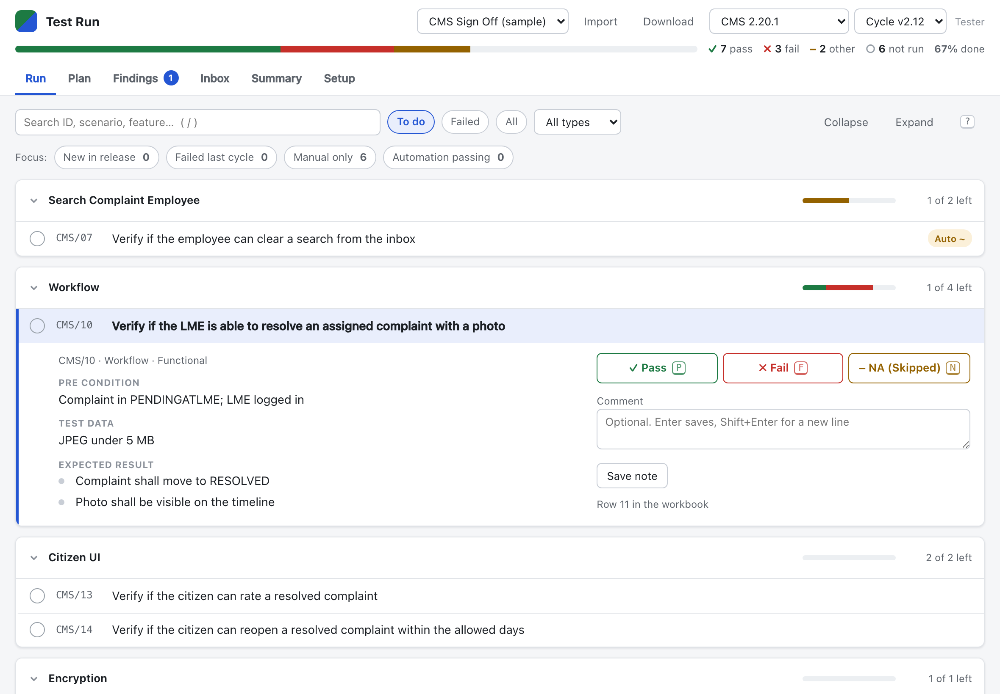
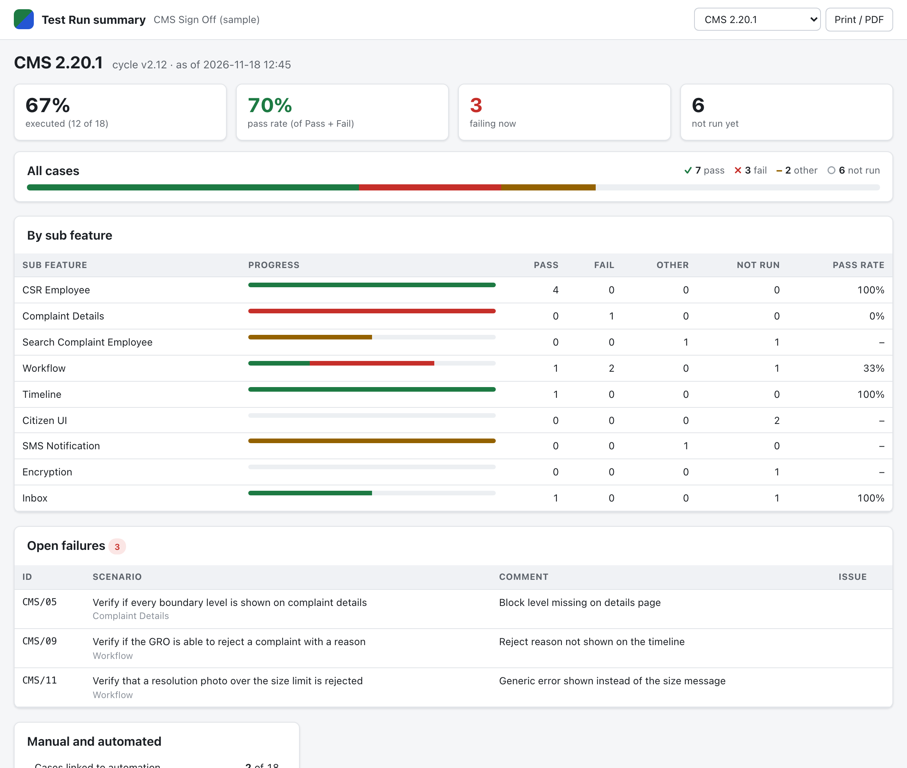

# Test Run console

A small app for **manual test runs on your test case workbooks** (`.xlsx`). It shows you what to test next, colour coded, and you mark results with one click or one key. Each result is saved straight into the workbook on your computer. Managers get a clean summary page you can print or send.

The workbooks stay on your laptop, in `sheets/`, which git ignores. To test as a team, share your Test Run: teammates open an invite link and mark results at the same time, and managers follow the summary (see [Sharing with your team](#sharing-with-your-team)).

| Run | Summary for management |
|---|---|
|  |  |

## Start it

You need Node.js 18 or later.

```bash
cd test-run-console
npm install
```

```bash
npm start
```

That opens http://127.0.0.1:5178. Put your workbooks in `test-run-console/sheets/`, or use **Import** in the console. Stop it with Ctrl+C in that terminal.

Want to look around first? Run `npm run demo`. It uses a throwaway copy of a sample workbook.

## What it does

Five screens: **Run**, **Known issues**, **Findings**, **Summary** and **Setup**.

- **Run.** Cases are grouped into *test paths*, by Feature then Sub feature.
  - Each case is one line: a status dot, the ID, the scenario and badges.
  - Click a case to see its pre condition, test data and expected result as bullets.
  - Mark it with **P**, **F**, **N** or a button. The next case in the list opens, and **U** undoes.
  - **Comment and issue link:** type them before or after choosing the result. Pressing a result saves all three and opens the next case. A failure with nothing typed yet stays open so you can describe it; press the result again (or **Save note**, or Enter) once you have.
  - **Clear a result:** press the chosen button again with nothing new typed (or **0**, or **Clear result**). The case goes back to not run, so you can come back to it.
- **Issue links.** Paste the issue's link (GitHub, GitLab, Jira or any `https://` page) in **Issue link**. Several are fine, separated by commas.
  - The workbook shows a short reference such as `#123`, linked to the issue, in the *Linked issue* column. If the tab has no such column, the first link adds one at the right of the table.
  - A cell can hold only one link in Excel, so a cell with several issues links to the first. Every issue keeps its own link in **Known issues** and its sheet.
- **Known issues.** Every issue in the workbook: from Issue links on test cases, and bugs Bug Reporter added as findings (not in the test cases yet).
  - Each shows its title, priority, state (open or closed) and its test cases. Click a case to open it in Run.
  - Titles, states and priorities of GitHub issues are filled in from GitHub, with the `gh` login on the laptop running Test Run. Priority comes from the issue's project board (a *Priority* field) or a label such as `P1`. **Refresh from GitHub** gets the latest. You can also type a title or priority with **✎**.
  - **Download** adds them to the workbook as a **Known issues** sheet: the issue (linked), title, priority, state, test cases and when it was added. The file in `sheets/` is not changed.
- **Colour and symbol together.** ✓ pass, ✗ fail, – other, ○ not run, so results stay readable for colour-blind readers and on paper.
- **Focus on risk.** Untested cases sort into four groups: new in this release, failed last cycle, manual only, and automation already passing.
- **Automation badges.** If the workbook has the automation sign-off tab, cases whose comment names a spec (e.g. `inbox-search.spec`) show its latest result: **Auto ✓**, **Auto ✗** or **Auto ~**.
- **Cycles.** Each cycle is a pair of columns, `Test Status` and `Comment`, as your sheets already have.
  - **Setup → Start new cycle** adds the next pair beside the last one, with the same header style, dropdown and formatting.
  - Earlier cycles stay, so you can compare. The cycle picker at the top switches between them.
- **Fix cases while you run.** Under the result buttons of an open case:
  - **✎ Edit case** (or **E**) changes the scenario, pre condition, test data, expected result or test type in the workbook. An optional note is added to the cycle's comment as `Updated: …`.
  - **⧉ Duplicate of…** picks the case to keep (similar ones are suggested). This one is struck out and its comment starts with `Duplicate of CMS/12: …`.
  - **⊘ Deprecate** asks why the case is no longer needed. The case is struck out and its comment starts with `Deprecated: …`.
  - Nothing is deleted: the text stays in the workbook, struck out, with the reason in the Comment of the current cycle. Status cells are left as they are.
  - Retired cases leave the to-do list, the progress bar and the Summary figures. The **Retired** filter lists them, and **Restore to the run** removes the strikethrough and the note.
  - The strikethrough on the Scenario cell is what marks a case as retired, so this survives Download, Google Sheets and Excel. A row someone strikes out by hand is treated the same way.
- **Findings.** Bugs and scenarios found while testing that are not in the test cases yet. They are what gets added to the final workbook.
  - They arrive from Bug Reporter (tick *Also add this to Test Run* and leave the test case empty), or you note one by hand.
  - **Write up as test case** opens the case, prefilled from the bug, right there. **Add to workbook** appends it with the next ID (`CMS/183`) and the last row's formatting.
  - **Already covered…** links it to an existing case instead.
  - **+ New test case** adds a case that has no finding behind it.
- **Summary.** Shows percent executed, pass rate, a colour strip per feature, open failures with issue links, and a comparison with the previous cycle. **Export summary** saves it as one HTML file you can send. **Update summary tab** writes it into the workbook.
- **Cells on several lines.** Legacy sheets often have several lines in one cell. The console reads them the way a person would:
  - lines become a list (bullet marks dropped, numbers like `1.` or `2,` kept);
  - a line that carries on the one before (a closing quote, lower case, or after "Dear Citizen,") stays with it;
  - a first line ending in `:` sits above its list.
  - In the case list a scenario on several lines reads `details: Type · Date · Status`. Editing a case shows the cell as it is, and saves it in the cell's own style.
- **Rows that fit their text.** Google Sheets downloads every row one line high, so wrapped cells show only their last line once the file is opened or uploaded again. Each save, and **Download**, grows rows to fit their wrapped text. Rows are only ever made taller.
- **Any layout.** Columns are found by header name, including headers on two lines such as `Test Status` / `v2.12`. Setup lets you fix anything it got wrong.

## Sharing with your team

Test Run runs on one laptop, yours. To share it, turn on **Setup → Team**. Other testers can then mark results at the same time, and managers can follow the run and the summary. Teammates install nothing: they open their invite link.

### 1. How your team reaches your laptop

Test Run only listens on your laptop, so a tunnel gives it an internet address. **Setup → Team** offers two ways:

| | Quick tunnel | Fixed address |
|---|---|---|
| Setup | `brew install cloudflared`, then **Start sharing** | Once: Tailscale Funnel, or a Cloudflare named tunnel |
| Address | New on every start, e.g. `https://words.trycloudflare.com` | Always the same, e.g. `https://my-mac.tail1234.ts.net` |
| Invite links | Last only with the hosted page and gist (below) | Always last |
| Best for | Trying it out | A team, every day |

**Quick tunnel.** `npm run share` (or **Start sharing**) opens a free [Cloudflare quick tunnel](https://developers.cloudflare.com/cloudflare-one/connections/connect-networks/do-more-with-tunnels/trycloudflare/), with no account.

- If it drops (sleep, a Wi-Fi change), Test Run opens it again by itself and says so in Setup.
- Sharing also starts again when you restart Test Run (`npm start`), until you press **Stop sharing**.
- Each start gets a new address. For invite links to survive that, you need both:
  - **Hosted page:** this console on GitHub Pages, `https://<owner>.github.io/<repo>/test-run/`. Invite links open there. It holds no data; it only talks to your laptop. To put it there, once:
    1. In the repository on GitHub: **Settings → Pages → Source: GitHub Actions**.
    2. Merge into `master`. The workflow [`.github/workflows/test-run-pages.yml`](../.github/workflows/test-run-pages.yml) publishes the console.
    3. In **Setup → Team**, use the suggested address and press **Check**. It must say *Live*. (A `github.com/…/tree/…` address is the repository page, not GitHub Pages, and is refused.)
  - **Keep the current address in a secret gist:** Test Run writes its address to a gist with your `gh` login, and the hosted page looks it up there.
- Until the hosted page is live, invite links name the current tunnel address. They stop working when it changes, and you make new ones (**New link**).

**Fixed address.** An address that never changes, so links always work and no hosted page or gist is needed.

- **[Tailscale Funnel](https://tailscale.com/kb/1223/funnel)** (free, no domain needed):
  1. Install Tailscale on your Mac (`brew install --cask tailscale`, or the App Store) and sign in.
  2. Run `tailscale funnel --bg 5178`. The first time, it gives you a link to allow Funnel for your account. It keeps running after restarts.
  3. Your address is `https://<this-mac>.<tailnet>.ts.net` (`tailscale funnel status` shows it). In **Setup → Team → Fixed address**, enter it (Test Run offers it when Tailscale is signed in) and press **Check**.
- **Cloudflare named tunnel** (needs a domain you manage in Cloudflare):
  1. `cloudflared tunnel login`
  2. `cloudflared tunnel create test-run`
  3. `cloudflared tunnel route dns test-run testrun.your-domain.org`
  4. In **Setup → Team**, enter `https://testrun.your-domain.org` as the fixed address and `test-run` as the tunnel name, then **Start tunnel**. Test Run runs it while sharing and starts it again if it drops.

**Check** fetches the address and confirms it reaches this Test Run (not another laptop's).

### 2. Invite people

In **Setup → Team**, add each person with what they can do:

| Can | Who | What they can do |
|---|---|---|
| Mark results | testers | Run: mark, clear, edit, deprecate and mark duplicates. Known issues: type titles and priorities. Findings: write them up. Summary. *Tested by* shows their name. |
| View only | managers | Run, Known issues and Summary, read-only. |

- Each person gets their own invite link. Send it to them privately. It is shown once; if it is lost, make a new one.
- Opening the link signs them in. Their browser keeps it, so they bookmark the page.
- **Remove** someone, or make them a **New link**: the old link stops working at once.
- Setup, cycles, workbooks and the team stay with you, at the laptop.

**While sharing:** your laptop must stay on and awake, and Test Run running. Everyone works on the same workbook. Marks are saved one at a time, and a mark that collides with someone else's is refused, with what they marked. Each page picks up others' changes every 10 seconds.

**How access works:**
- Requests from your own laptop (http://127.0.0.1:5178) need no key, as before.
- Everything that comes through the tunnel must carry an invite key.
- Only a hash of each key is stored, in `sheets/.testrun/app.json`, never the key itself.
- The page itself is public; the workbook, issues, findings and summary are not.

## With Bug Reporter

When Test Run is reachable, Bug Reporter's **Report Issue** form has a Test Run box, above the Claude options:

- **Also add this to Test Run:** tick it to add the bug once it is filed. The choice is remembered.
- **Test suite:** the workbook › tab. It starts on the one you picked last, else the one open in Test Run.
- **Test case (optional):** type an ID or a few words and pick from the list.
  - **With a test case:** that case is marked failed in the current cycle, the issue is linked to it, and its comment gets `Bug #123: <title>`. A case already failing keeps its result.
  - **Without one:** the bug becomes a finding in that suite, with the title, issue link, drafted Actual and Expected text and module, ready to **Write up as test case**.
  - Either way, the issue is listed in **Known issues** with the title and priority you filed it with.
- The review screen repeats what will happen in Test Run, next to **File issue**.
- **Settings:** Bug Reporter options → **Test Run**: the on/off switch; **Test Run address** (empty for Test Run on this computer); **Invite link** (paste the link your test lead sent; when the shared address changes, Bug Reporter finds the new one through the gist); **Check now**.

Loading this branch's Bug Reporter: in `chrome://extensions`, remove the Bug Reporter you have loaded, then **Load unpacked** this worktree's `bug-reporter/extension` folder. Both copies have the same extension ID, so only one can be loaded at a time; the native helper keeps working without reinstalling.

## Your workbooks

- **Where they live:** `sheets/*.xlsx`, never committed. Settings and findings for a workbook are kept beside it in `sheets/.testrun/<workbook>.json`, so the workbook itself only holds test data. Your name and the team are in `sheets/.testrun/app.json`.
- **What changes in the workbook:**
  - the status, comment and issue cells you mark (the first issue link adds a *Linked issue* column if the tab has none);
  - case text you edit, and the strikethrough on cases you deprecate or mark as duplicates;
  - and only when you ask: new cycle columns, added rows, the optional *Tested by*, *Tested on* and *Release* columns, and the *Test Run Summary* tab.
- **Safe saving:** each change is written to a temporary file first, which then replaces the workbook. The first save each day also keeps a copy in `sheets/.testrun/backups/` (14 days).
- **Excel:** if you edit the workbook in Excel and save, Test Run reloads it and never overwrites a cell that changed. While Excel has it open, a banner reminds you to close it there.
- **Publishing:** **Download** the workbook and upload it to Google Drive. If you keep it there as an `.xlsx` file, *Manage versions → Upload new version* keeps the same link.

## Running a cycle well

1. **Setup:** start the cycle (e.g. `v2.20.1`). If you tag cases by release, set the release in scope. Sharing? Start sharing and send the invite links.
2. **Work path by path.** Stay on one login and reuse the same complaint while it moves through its states.
3. **Take the Focus order:** new in this release first, then what failed last time. Glance at or skip **Auto ✓** cases.
4. **A failure:** paste the issue link with the result. Filing it with Bug Reporter? Tick *Also add this to Test Run* and pick the test case: it is marked failed with the link for you.
5. **Unplanned failure:** file it with Bug Reporter with no test case picked (it becomes a finding), or note a finding by hand.
6. **End of day:**
   1. **Findings:** write each one up, or mark it as already covered.
   2. **Known issues:** check titles and priorities.
   3. **Summary:** **Export summary** or print it. **Download** the workbook for the Known issues sheet.

## Development

```
server.mjs     the server (listens on 127.0.0.1 only; teammates come through a tunnel)
lib/
  core.js        pure logic: columns, statuses, IDs, risk order, paths, retired cases, summary
  sheet.js       reads and writes a workbook through a small sheet API
  api.js         the api_* functions the page calls
  xlsx-book.mjs  that sheet API on real .xlsx files (exceljs)
  books.mjs      the sheets folder: open, reload, safe save, backups, import
  store.mjs      the sidecar file beside each workbook
  team.mjs       invite keys, roles, local vs tunnelled requests, invite links
  share.mjs      the Cloudflare tunnel (quick or named), and the gist that keeps its address
  issues.mjs     GitHub issue titles, states and priorities, through gh
  prompts.js     prompts from the Claude drafting there was (off for now; kept for later)
  runtime.mjs    loads the logic for the server and the tests
ui/            the console and summary pages (also what GitHub Pages serves)
dev/           in-memory sheet API, sample workbook (made-up cases), fake cloudflared and gh
test/          unit tests, HTTP and team tests, and browser tests (console; Bug Reporter + Test Run)
```

```bash
npm test          # everything; the browser tests skip without Playwright
npm run prompts   # regenerate prompts/*.md after editing lib/prompts.js
```

- **The two back ends must agree.** The server tests run against both the in-memory sheet API and real `.xlsx` files.
- **Browser tests** look for Playwright in `PLAYWRIGHT_DIR`, or in the CCRS `tests/integration-tests` checkout.

### Safety notes

- **Who can call it:**
  - The server listens on 127.0.0.1 only.
  - API calls must carry an `X-Test-Run` header.
  - Without a key, only the laptop itself is let in: the Host must be 127.0.0.1 or localhost, no proxy headers, and the call must come from the console's own page or the Bug Reporter extension (its ID comes from the manifest key). Other web pages are refused.
  - Everyone else needs an invite key (`Authorization: Bearer …`), checked against stored hashes. Testers and viewers each get a fixed list of api_* functions (`lib/team.mjs`).
  - CORS is open to any page, because no cookies are used and the key is the only credential.
- **What it writes:** text that looks like a formula (`=…`, `+…`) is stored as text; imports must be real `.xlsx` files; workbook names cannot leave the sheets folder.
- **Claude drafting** is switched off in the console for now. The prompt and reply checks in `lib/` stay, with their tests, for when it comes back.
